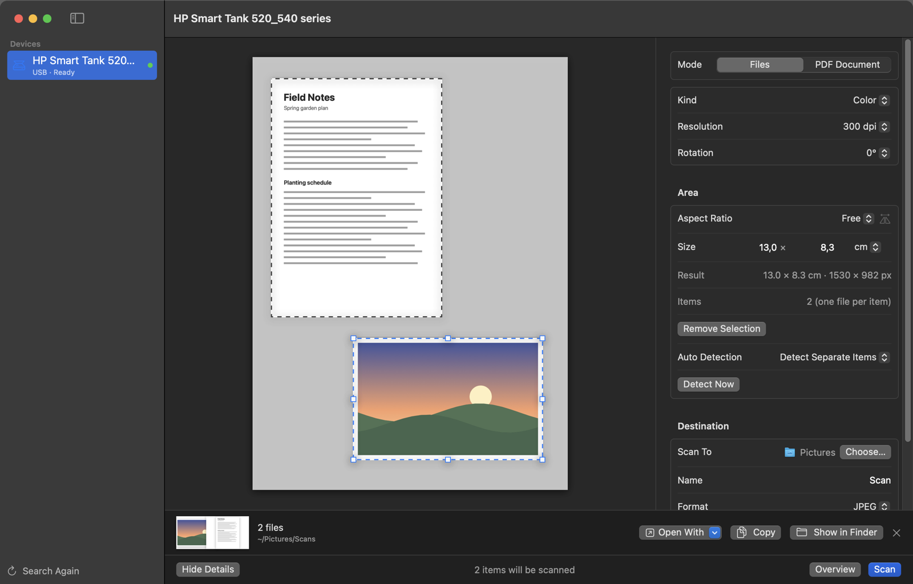
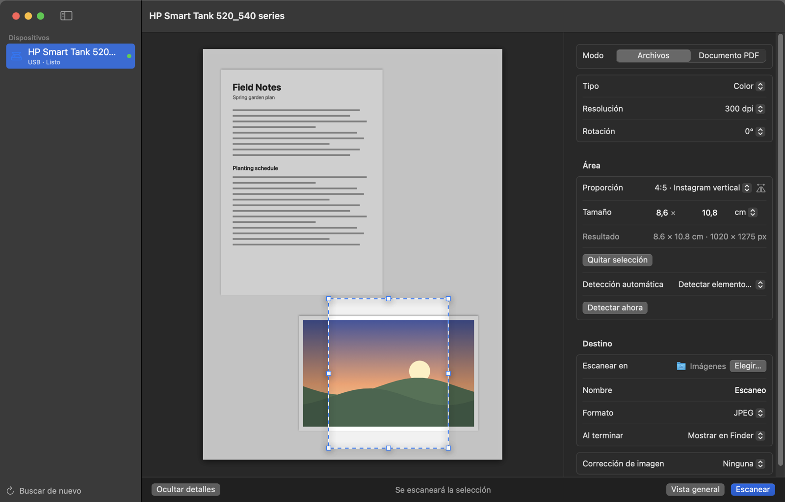
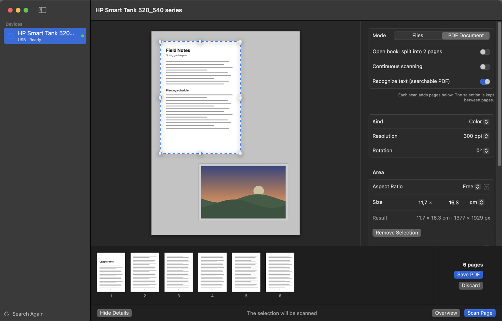

# HP Smart Tank 520 Scanner for macOS

**HPST520 Scanner** is a native macOS app for scanning with the **HP Smart Tank 520** over USB. It needs **no HP drivers** and bypasses the macOS service that leaves Image Capture stuck on *"Waiting for scanner"*.

It follows the Image Capture workflow: a quick overview of the glass, then a high-resolution scan of only the area you select. On top of that it adds:

- **Multiple selections** in one scan (one file per item), with **automatic detection** of the document or of each photo, plus deskew.
- **Aspect-ratio presets** for social media: 1:1, 4:5, 9:16, 16:9, 1.91:1 and more, portrait and landscape. The file comes out at the exact ratio (e.g. 1080 × 1350).
- **Document PDF mode** for books and long documents:
  - scan page by page;
  - split an open book into two pages;
  - continuous scanning with time to turn the page;
  - drag to reorder;
  - **searchable PDF** with OCR (English and Spanish).
- Color, grayscale and black & white, rotation, brightness, contrast, sharpness and threshold.
- Save as JPEG, PNG, TIFF, HEIC or PDF. **Open With** any app (Affinity, Photoshop, Preview…), **Copy** to the clipboard, or drag the thumbnail out.

> The app is in **English and Spanish** and follows your Mac's language. Other system languages get English.
>
> Not affiliated with HP Inc. "HP" and "Smart Tank" are trademarks of HP Inc. and are used only to describe compatibility.

## Screenshots

Overview of the glass with two detected items, each saved as its own file:



Aspect-ratio lock (4:5 for Instagram):



Document PDF mode for books and multi-page documents:



*The screenshots use generated sample content, not real scans.*

> **Need to print, not scan?** See [Looking to print over USB?](#looking-to-print-over-usb)

## Requirements

- macOS 14 Sonoma or later. The app is a universal build for **Apple Silicon** and Intel Macs.
- The printer connected **with a USB cable**.
- Nothing else: no Python, Homebrew or drivers.

**Tested with:** HP Smart Tank 520 (USB ID `03f0:4554`, which reports itself as "Smart Tank 520_540 series").

**May also work with** other printers that scan over eSCL through IPP-over-USB, such as other Smart Tank, recent DeskJet and ENVY models, and printers from other brands that support "AirPrint/AirScan over USB". These are untested. If you try one, please open an issue and say whether it worked.

## Install

1. Download `HPST520-Scanner-…-macOS.zip` from [Releases](../../releases) and unzip it.
2. Move **HPST520 Scanner.app** to Applications.
3. The app is not notarized by Apple, so the first time macOS will say it can't verify the developer. To open it, use one of these:
   - In Finder, **right-click → Open → Open**.
   - Or go to **System Settings → Privacy & Security**, scroll to the "HPST520 Scanner" notice and click **Open Anyway**.
   - Or run in Terminal: `xattr -dr com.apple.quarantine "/Applications/HPST520 Scanner.app"`

Quit **Image Capture** and **Preview** while scanning, because the scanner serves one app at a time.

## Looking to print over USB?

This app only **scans**. For **printing**, this setup works on our test Mac (Smart Tank 520 over USB, macOS 15): HP's macOS driver for the **HP Smart Tank 500 series**.

- That driver is for an older sibling model and doesn't mention the 520, but it prints fine with it.
- The driver is universal, so it runs natively on Apple Silicon without Rosetta.
- It's a workaround that worked for us, not something HP documents for the 520.

1. Download **HP Easy Start** from HP:
   - Direct download: [HP_Easy_Start.app.zip](https://ftp.hp.com/pub/softlib/software12/HP_Quick_Start/osx/HP_Easy_Start.app.zip) (from `ftp.hp.com`).
   - HP's page: [HP Easy Start](https://support.hp.com/us-en/drivers/selfservice/hp-easy-start/7376041).
   - Or with Homebrew: `brew install --cask hp-easy-start`.
2. Connect the printer with the USB cable, open HP Easy Start, and let it install the software for your printer. On our test Mac it installed the **HP Smart Tank 500 series** driver.
3. If the printer doesn't appear, or macOS picks a generic driver, add it yourself: go to **System Settings → Printers & Scanners → Add Printer**, select the Smart Tank (USB), then under **Use** choose **Select Software… → HP Smart Tank 500 series**.

Some people on HP's forum report that HP Easy Start finishes without installing any driver. In that case **HP Smart Tank 500 series** won't appear in step 3 either. We haven't hit this ourselves, so we can't confirm a fix. If it works or fails for you, please open an issue.

If Safari saves the download as `HP_Easy_Start.app.zip.download`, delete it and download it again, or use another browser.

HP Easy Start and the driver are HP's software and aren't part of this project. HP's own scanning software doesn't support the 520 over USB on macOS, which is why this app exists.

## Quick start

| Action | How |
|---|---|
| Preview the glass | **Overview** (⌥⌘R) |
| Select an area | Drag on the preview. Hold ⇧ or ⌘ to add more areas |
| Lock the aspect ratio | Details → Area → **Aspect Ratio**. The ↔ button switches portrait/landscape |
| Scan | **Scan** (⌘R). Cancel with ⌘. |
| Book / multi-page PDF | **PDF Document** mode (⌘B) → **Scan Page** → **Save PDF** (⌘S) |
| Copy the last scan | **Copy** or ⌘C |

## Why Image Capture and the HP driver fail

This printer doesn't use a classic scanner driver. It scans with **eSCL**, which is HTTP and XML carried over USB (IPP-over-USB).

On macOS that channel goes through a system proxy, `ippusbd`, which **gets out of sync**. If an app disconnects before reading a whole response, the leftover data is handed to the next app as its answer. From then on, Image Capture hangs on "Waiting for scanner" or fails with error `-21345`.

HP's "HP Scanner 3" module doesn't include this model, so installing HP's software doesn't help.

This app talks eSCL to the USB interface directly through libusb. It clears out any leftover data and reads one USB packet at a time, so scans stay reliable.

The full write-up is in [docs/diagnosis.md](docs/diagnosis.md).

## Build from source

You need the Xcode Command Line Tools (`xcode-select --install`).

```sh
app/build.sh             # → app/build/HPST520 Scanner.app (universal)
app/build.sh --install   # also copies it to ~/Applications
app/build.sh --release   # also creates dist/HPST520-Scanner-<version>-macOS.zip
app/tests/run.sh         # tests (the scanner tests need the printer connected)
app/tests/run.sh --offline
```

`build.sh` downloads **libusb**, verifies it with SHA-256, builds it as a universal library and bundles it inside the app. The version is pinned.

To sign with a developer identity:

```sh
SIGN_ID="Developer ID Application: …" app/build.sh --release
```

To regenerate the screenshots:

```sh
ESCANER_DEMO=/tmp/shots "app/build/HPST520 Scanner.app/Contents/MacOS/HPST520Scanner" -AppleLanguages "(en)"
```

### Layout

```
app/        SwiftUI app: Backend.swift (eSCL-over-USB driver), model, UI, image processing, PDF and OCR
app/Resources/  Translations (en.lproj). The Spanish source strings are the keys; check with scripts/check-l10n.py
app/tests/  Tests (with and without the scanner)
cli/        Command-line version in Python (hpscan.py), where the project started
scripts/    libusb build
docs/       Diagnosis of the macOS issue, screenshots
```

### Command line (optional)

```sh
brew install libusb && python3 -m venv .venv && .venv/bin/pip install pyusb
cli/escanear -o ~/Desktop/document.pdf --dpi 300
.venv/bin/python cli/hpscan.py info
```

## License

[MIT](LICENSE). The app bundles **libusb** (LGPL-2.1) as a separate dynamic library. See [THIRD_PARTY_NOTICES.md](THIRD_PARTY_NOTICES.md).
